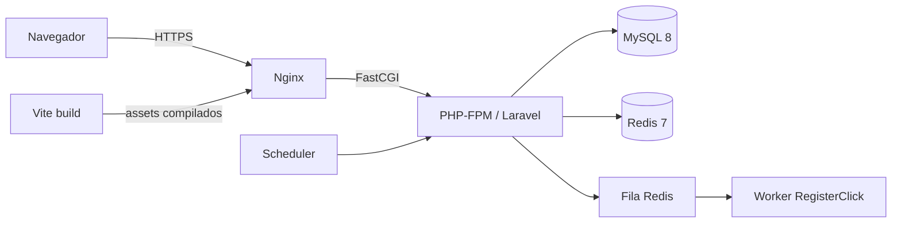

# EncurtaLink

[](https://laravel.com)
[](https://www.php.net/)
[](https://htmx.org/)
[](https://www.mysql.com/)
[](https://redis.io/)
[

Encurtador de links com autenticação, CRUD protegido, redirecionamento público, cache Redis, filas assíncronas e analytics de cliques. A interface utiliza Blade, HTMX e Tailwind CSS, sem depender de uma SPA.

> **Status:** o projeto está em desenvolvimento. Este documento descreve o escopo, a arquitetura e o contrato de entrega; valide a implementação disponível antes de utilizar uma funcionalidade.

## Motivação

Links longos dificultam o compartilhamento e podem atrapalhar a leitura em mensagens, redes sociais e publicações. O EncurtaLink oferece uma URL curta, facilita a divulgação pública e mantém um histórico mínimo de interações para que o usuário possa acompanhar o desempenho dos links sob sua responsabilidade.

A proposta combina simplicidade de uso com uma arquitetura server-side: a maior parte da interface é renderizada pelo Laravel, enquanto o HTMX atualiza apenas os trechos necessários. O redirecionamento usa cache Redis para reduzir latência, e o registro de cliques acontece por uma fila assíncrona para não bloquear a resposta pública.

## Objetivos

### Objetivo geral

Desenvolver uma aplicação web de encurtamento de URLs com autenticação, gerenciamento de links, redirecionamento rápido e métricas básicas de acesso.

### Objetivos específicos

- Permitir que usuários autenticados criem, consultem, editem e removem seus links.
- Disponibilizar o redirecionamento público por meio de `/r/{slug}`.
- Reduzir a latência do redirecionamento com cache Redis.
- Registrar cliques de forma assíncrona usando Laravel Queue e Redis.
- Exibir total de cliques e série diária no dashboard.
- Proteger operações de escrita com autenticação, autorização e rate limiting.
- Manter a interface server-side com Blade, HTMX e Tailwind CSS.
- Preparar o projeto para implantação por Docker Compose e Coolify.
- Documentar requisitos, arquitetura, banco de dados, rotas e decisões de produto.

## Funcionalidades

- Landing page com acesso ao produto e redirecionamento para autenticação.
- Cadastro, login, logout e recuperação de senha por meio do Laravel Breeze.
- CRUD de links restrito ao usuário autenticado.
- Criação rápida pelo endpoint `POST /s`, também protegida por autenticação.
- Slug gerado automaticamente com 4 a 10 caracteres.
- Redirecionamento público `GET /r/{slug}` com resposta HTTP 302.
- Resposta 410 para links expirados e 404 para slugs inexistentes.
- Cache de resolução de slugs no Redis.
- Registro assíncrono de cliques com job `RegisterClick`.
- Dashboard com total de cliques e série diária.
- Filtro, busca e paginação de links.
- Dark mode com Tailwind CSS.
- Interface responsiva com partials HTMX.

## Stack

| Camada | Tecnologia | Uso no projeto |
|---|---|---|
| Linguagem | PHP 8.5 | Runtime da aplicação |
| Framework | Laravel 13 | Backend, rotas, Eloquent e filas |
| Autenticação | Laravel Breeze | Login, cadastro, recuperação de senha e logout |
| Frontend | Blade + HTMX 2 | Renderização server-side e interações parciais |
| Estilo | Tailwind CSS 4 | Layout responsivo e dark mode |
| Build | Vite | Compilação de CSS e JavaScript |
| Banco de dados | MySQL 8 | Dados persistentes com `utf8mb4` |
| Cache | Redis 7 | Cache de slugs e demais estruturas voláteis |
| Sessão e fila | Redis 7 | Sessões, cache e Laravel Queue |
| Containers | Docker Compose | Ambientes de desenvolvimento e implantação |
| Servidor web | Nginx + PHP-FPM | Exposição da aplicação em produção |
| Deploy | Coolify | Build, variáveis, proxy reverso e HTTPS |

## Arquitetura



### Componentes

- **Nginx:** proxy reverso, TLS e entrega dos assets públicos.
- **PHP-FPM/Laravel:** regras de negócio, autenticação, renderização e operações internas.
- **MySQL:** fonte de verdade para usuários, links e cliques.
- **Redis:** cache de slugs, sessões, cache da aplicação e filas.
- **Queue worker:** processa `RegisterClick` fora do ciclo da requisição.
- **Scheduler:** executa tarefas agendadas e rotinas de manutenção.
- **Vite:** compila Tailwind e o JavaScript mínimo necessário para HTMX.

### Fluxo de criação

```text
POST /links ou POST /s
  -> autenticação e validação
  -> geração de slug único
  -> persistência no MySQL
  -> atualização do cache Redis
  -> retorno do partial Blade para o HTMX
```

### Fluxo de redirecionamento

```text
GET /r/{slug}
  -> busca no cache Redis
  -> em caso de cache miss, consulta o MySQL
  -> verifica expiração
  -> registra o click via fila
  -> redirect()->away(url, 302)
```

O TTL do cache deve ser limitado pela data de expiração do link. Atualizações e remoções devem invalidar a chave `link:{slug}`.

## Rotas

### Rotas públicas

| Método | Rota | Descrição | Resposta |
|---|---|---|---|
| GET | `/` | Landing page | Blade |
| GET | `/r/{slug}` | Redirecionamento público | HTTP 302 |
| GET/POST | `/login` | Autenticação | Breeze |
| GET/POST | `/register` | Cadastro | Breeze |
| GET/POST | `/forgot-password` | Recuperação de senha | Breeze |

### Rotas autenticadas

| Método | Rota | Descrição | Interação |
|---|---|---|---|
| GET | `/dashboard` | Visão geral | Blade |
| GET | `/links` | Lista, busca, filtro e paginação | HTMX |
| POST | `/links` | Criação de link | HTMX |
| POST | `/s` | Criação rápida autenticada | HTMX |
| GET | `/links/{id}/edit` | Formulário de edição | HTMX |
| PUT/PATCH | `/links/{id}` | Atualização de link | HTMX |
| DELETE | `/links/{id}` | Remoção de link | HTMX |
| GET | `/links/{id}/stats` | Total e série diária | HTMX polling |
| POST | `/logout` | Encerrar sessão | Redirect |

O parâmetro de slug aceita `[A-Za-z0-9_-]{4,10}`. Slugs gerados serão normalizados para minúsculas para evitar ambiguidade entre maiúsculas e minúsculas.

## Regras de domínio

- A criação, edição e remoção exigem usuário autenticado.
- O redirecionamento em `/r/{slug}` é público.
- Cada link pertence ao usuário autenticado que o criou.
- A `LinkPolicy` protege visualização, edição, remoção e consulta de estatísticas.
- O endpoint rápido `POST /s` aplica `throttle:20,1`.
- A URL deve usar os esquemas `http` ou `https` e passar por validação no request.
- Slugs duplicados são rejeitados pelo índice único e devem ser gerados novamente.
- A remoção de um link invalida seu cache e os registros associados são removidos em cascata.
- Links expirados retornam 410 Gone; slugs inexistentes retornam 404 Not Found.
- O redirecionamento usa 302 para preservar a possibilidade de medir cliques.
- O registro de IP, user agent e referer deve ser tratado como dado de analytics e ter política de retenção definida.

## Modelo de dados

### `users`

Tabela padrão do Laravel Breeze, com `id`, `name`, `email`, `password`, `email_verified_at` e timestamps.

### `links`

| Coluna | Tipo | Restrição/uso |
|---|---|---|
| `id` | BIGINT UNSIGNED | Primary key |
| `slug` | VARCHAR(10) | Único, indexado |
| `original_url` | TEXT | URL de destino, sem índice |
| `user_id` | BIGINT UNSIGNED | FK para `users`, nullable para preservar links |
| `expires_at` | TIMESTAMP NULL | Expiração opcional |
| `created_at` | TIMESTAMP | Criação |
| `updated_at` | TIMESTAMP | Atualização |

Índices: `slug` único, `user_id` e `expires_at`.

### `clicks`

| Coluna | Tipo | Restrição/uso |
|---|---|---|
| `id` | BIGINT UNSIGNED | Primary key |
| `link_id` | BIGINT UNSIGNED | FK para `links`, cascade on delete |
| `ip` | VARCHAR(45) | Origem da requisição |
| `user_agent` | VARCHAR(512) | Navegador e dispositivo |
| `referer` | VARCHAR(512) | Origem do tráfego |
| `clicked_at` | TIMESTAMP | Data do click, valor padrão current |

Índice composto: `(link_id, clicked_at)`.

Todas as tabelas devem usar `utf8mb4` e `utf8mb4_unicode_ci`.

## Analytics

O primeiro incremento do dashboard apresenta:

- Total de cliques acumulados.
- Série diária de cliques por link.
- Intervalo inicial de consulta definido pela interface.
- Atualização por HTMX sem recarregar a página inteira.

A tabela `clicks` é a fonte de verdade. Redis pode ser usado como cache de leitura, mas não deve substituir a persistência dos eventos de click.

## Segurança

- `LinkPolicy` para impedir acesso a links de outro usuário.
- Token CSRF em formulários e requisições HTMX.
- `throttle:20,1` no endpoint de criação rápida.
- Validação de URL e limite de tamanho compatível com `TEXT`.
- HTTPS e `SESSION_SECURE_COOKIE=true` em produção.
- `APP_DEBUG=false` em produção.
- Senhas, chaves e credenciais exclusivamente por variáveis de ambiente.
- Portas do MySQL e Redis sem exposição pública.
- Execução de migrations por etapa de release, não em todos os workers.
- Rotação e retenção de logs conforme a política do ambiente.

## Como rodar localmente

### Pré-requisitos

- Docker Engine com Docker Compose.
- Node.js 20 ou superior.
- Git.

### Arquivos do Docker Compose

- `compose.yaml`: ambiente local baseado no Laravel Sail, com Nginx, MySQL, Redis, Mailpit e Selenium.
- `docker-compose.yml`: topologia de produção consumida pelo Coolify, com aplicação PHP-FPM, Nginx, workers, scheduler, MySQL e Redis.
- O arquivo de produção não declara `ports` nem `expose`; todos os serviços se comunicam pela rede interna do Compose.
- O proxy do Coolify configura a entrada pública e encaminha o tráfego para `web:80`.

### Rede, volumes e saúde dos serviços

- Os containers de produção pertencem à rede bridge privada `encurta-link-network`.
- MySQL e Redis usam volumes nomeados, respectivamente `mysql_data` e `redis_data`.
- `db` e `redis` possuem healthchecks e os serviços dependentes aguardam `service_healthy`.
- `app`, `queue`, `scheduler`, `db` e `redis` permanecem internos e não publicam portas.
- O serviço `web` executa o Nginx e é o alvo interno do proxy do Coolify.
- O Compose local pode publicar portas no host para facilitar o desenvolvimento.

### Instalação

Substitua `<URL_DO_REPOSITORIO>` pela URL do repositório antes de executar:

```bash
git clone <URL_DO_REPOSITORIO> encurta-link
cd encurta-link
composer install
cp .env.example .env
docker compose up -d
docker compose exec laravel.test php artisan key:generate
docker compose exec laravel.test php artisan migrate --seed
docker compose exec laravel.test php artisan storage:link
```

O `compose.yaml` é o arquivo local do Sail. Para executar comandos no container da aplicação:

```bash
docker compose exec laravel.test php artisan about
```

Para desenvolvimento do frontend com Vite:

```bash
docker compose exec laravel.test npm run dev
```

Acesse a aplicação em `http://localhost` ou na URL configurada em `APP_URL`. O Vite fica disponível na porta `5173` durante o desenvolvimento.

### Variáveis principais

Copie `.env.example` para `.env` e configure, no mínimo:

```dotenv
APP_NAME=EncurtaLink
APP_ENV=local
APP_DEBUG=true
APP_URL=http://localhost
APP_KEY=
LOG_CHANNEL=stack
LOG_LEVEL=debug

DB_CONNECTION=mysql
DB_HOST=mysql
DB_PORT=3306
DB_DATABASE=encurta_link
DB_USERNAME=app
DB_PASSWORD=password

REDIS_HOST=redis
REDIS_PORT=6379
CACHE_STORE=redis
SESSION_DRIVER=redis
QUEUE_CONNECTION=redis
```

O `docker-compose.yml` de produção sobrepõe os hosts de infraestrutura para `DB_HOST=db` e `REDIS_HOST=redis` durante o deploy. Nunca versionar `.env` ou inserir credenciais reais no repositório.

## Testes e qualidade

Comandos previstos para a aplicação no ambiente Sail:

```bash
docker compose exec laravel.test php artisan test
docker compose exec laravel.test vendor/bin/pint --test
docker compose exec laravel.test php artisan route:list
docker compose exec laravel.test npm run build
```

A suíte deve cobrir, no mínimo:

- Criação e atualização de links pelo usuário autenticado.
- Bloqueio de edição e remoção entre usuários diferentes.
- Slug duplicado e expiração de link.
- Redirecionamento 302 e cache miss.
- Respostas 404 e 410.
- Registro assíncrono de clicks.
- Filtro, busca e paginação.
- Respostas de validação e rate limiting.

## Deploy no Coolify

1. Conectar o repositório GitHub ao recurso da aplicação.
2. Selecionar Docker Compose como build pack; o Coolify usa automaticamente `docker-compose.yml` como arquivo de produção.
3. Configurar as variáveis de `APP_*`, `DB_*` e `REDIS_*`.
4. Definir `APP_ENV=production`, `APP_DEBUG=false` e `APP_URL` com HTTPS.
5. Configurar o proxy do Coolify para encaminhar tráfego ao serviço `web` na porta interna 80; manter `app`, `queue`, `scheduler`, `db` e `redis` internos. O Compose de produção não declara `ports` nem `expose`.
6. Executar `docker compose -f docker-compose.yml run --rm app php artisan migrate --force` em uma etapa de release.
7. Configurar o domínio e o certificado TLS gerenciado pelo proxy.
8. Agendar backup do volume `mysql_data`.
9. Confirmar que as portas 3306 e 6379 não estão publicadas externamente.

O build de produção executa `npm run build` durante a construção da imagem. O serviço `queue` executa `php artisan queue:work` e o serviço `scheduler` executa `schedule:run` em loop.

## Estrutura do repositório

```text
.
├── app/
│   ├── Http/
│   ├── Jobs/
│   ├── Models/
│   ├── Policies/
│   └── Providers/
├── database/
│   ├── factories/
│   ├── migrations/
│   └── seeders/
├── docker/
├── docs/
├── nginx/
├── resources/
│   ├── css/
│   ├── js/
│   └── views/
├── routes/
├── tests/
│   ├── Feature/
│   └── Unit/
├── .env.example
├── Dockerfile
├── compose.yaml
├── docker-compose.yml
├── composer.json
├── package.json
└── phpunit.xml
```

## Artefatos de engenharia

Os documentos de produto e arquitetura devem ser mantidos em [`docs/`](docs/) e vinculados a esta página:

- [Requisitos e prioridade MoSCoW](docs/requisitos.md)
- [Casos de uso](docs/casos-de-uso.md)
- [Diagrama de classes](docs/diagrama-de-classes.md)
- [Sequência de cadastro e login](docs/sequencia-cadastro-login.md)
- [Sequência de criação de link](docs/sequencia-criar-link.md)
- [Sequência de redirecionamento](docs/sequencia-redirecionamento.md)
- [Componentes e implantação](docs/componentes-implantacao.md)
- [DER do banco de dados](docs/der.md)
- [Dicionário de dados](docs/dicionario-de-dados.md)
- [Backlog do produto](docs/backlog.md)
- [Planejamento de sprints](docs/sprints.md)
- [Wireframes e mockups](docs/wireframes.md)
- [Mapa de endpoints HTMX](docs/rotas-htmx.md)
- [Mini design system](docs/design-system.md)

## Planejamento

| Sprint | Entrega |
|---|---|
| Sprint 0 | Repositório, README, ambiente Docker e o baseline técnico |
| Sprint 1 | Breeze, MySQL, migrations, models e autenticação |
| Sprint 2 | CRUD de links com HTMX e Tailwind |
| Sprint 3 | Redirecionamento, Redis, expiração e filas |
| Sprint 4 | Analytics, dashboard e deploy Coolify |
| Sprint 5 | Artefatos, revisão final, testes e vídeo |

## Vídeo de apresentação

O vídeo deve ter no máximo três minutos e permanecer público, sem listagem. O link será adicionado antes da entrega:

[Assistir ao vídeo](LINK_DO_VIDEO)

## Licença

A licença do projeto será definida antes da submissão. O arquivo `LICENSE` deve ser incluído quando a licença for escolhida.

## Convenções

- PHP segue o padrão PSR-12 e a formatação do Laravel Pint.
- Rotas de escrita usam autenticação e autorização.
- Interações de interface que atualizam um trecho usam partials HTMX.
- Migrações, jobs, policies e testes acompanham as funcionalidades correspondentes.
- Funcionalidades concluídas devem ser validadas por testes automatizados antes da entrega.
