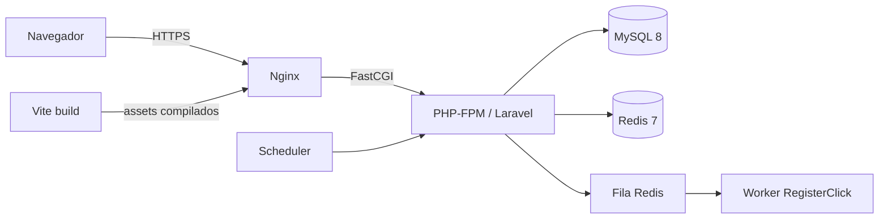

# EncurtaLink

[](https://laravel.com)
[](https://www.php.net/)
[](https://htmx.org/)
[](https://www.mysql.com/)
[](https://redis.io/)
[

Encurtador de links com autenticação, CRUD protegido, redirecionamento público, cache Redis, filas assíncronas e analytics de cliques. A interface utiliza Blade, HTMX e Tailwind CSS, sem depender de uma SPA.

> **Status:** o projeto está em desenvolvimento. Este documento descreve o escopo, a arquitetura e o contrato de entrega; valide a implementação disponível antes de utilizar uma funcionalidade.

## Motivação

Links longos dificultam o compartilhamento e podem atrapalhar a leitura em mensagens, redes sociais e publicações. O EncurtaLink oferece uma URL curta, facilita a divulgação pública e mantém um histórico mínimo de interações para que o usuário possa acompanhar o desempenho dos links sob sua responsabilidade.

A proposta combina simplicidade de uso com uma arquitetura server-side: a maior parte da interface é renderizada pelo Laravel, enquanto o HTMX atualiza apenas os trechos necessários. O redirecionamento usa cache Redis para reduzir latência, e o registro de cliques acontece por uma fila assíncrona para não bloquear a resposta pública.

## Objetivos

### Objetivo geral

Desenvolver uma aplicação web de encurtamento de URLs com autenticação, gerenciamento de links, redirecionamento rápido e métricas básicas de acesso.

### Objetivos específicos

- Permitir que usuários autenticados criem, consultem, editem e removem seus links.
- Disponibilizar o redirecionamento público por meio de `/r/{slug}`.
- Reduzir a latência do redirecionamento com cache Redis.
- Registrar cliques de forma assíncrona usando Laravel Queue e Redis.
- Exibir total de cliques e série diária no dashboard.
- Proteger operações de escrita com autenticação, autorização e rate limiting.
- Manter a interface server-side com Blade, HTMX e Tailwind CSS.
- Preparar o projeto para implantação por Docker Compose e Coolify.
- Documentar requisitos, arquitetura, banco de dados, rotas e decisões de produto.

## Funcionalidades

- Landing page com acesso ao produto e redirecionamento para autenticação.
- Cadastro, login, logout e recuperação de senha por meio do Laravel Breeze.
- CRUD de links restrito ao usuário autenticado.
- Slug gerado automaticamente com 4 a 10 caracteres.
- Redirecionamento público `GET /r/{slug}` com resposta HTTP 302.
- Resposta 410 para links expirados e 404 para slugs inexistentes.
- Cache de resolução de slugs no Redis.
- Registro assíncrono de cliques com job `RegisterClick`.
- Dashboard com total de cliques e série diária.
- Filtro, busca e paginação de links.
- Dark mode com Tailwind CSS.
- Interface responsiva com partials HTMX.

## Stack

| Camada | Tecnologia | Uso no projeto |
|---|---|---|
| Linguagem | PHP 8.5 | Runtime da aplicação |
| Framework | Laravel 13 | Backend, rotas, Eloquent e filas |
| Autenticação | Laravel Breeze | Login, cadastro, recuperação de senha e logout |
| Frontend | Blade + HTMX 2 | Renderização server-side e interações parciais |
| Estilo | Tailwind CSS 4 | Layout responsivo e dark mode |
| Build | Vite | Compilação de CSS e JavaScript |
| Banco de dados | MySQL 8 | Dados persistentes com `utf8mb4` |
| Cache | Redis 7 | Cache de slugs e demais estruturas voláteis |
| Fila | Redis 7 | Laravel Queue e processamento assíncrono |
| Sessão | Filesystem | `storage/framework/sessions/` com `SESSION_DRIVER=file` |
| Containers | Docker Compose | Ambientes de desenvolvimento e implantação |
| Servidor web | Nginx + PHP-FPM | Exposição da aplicação em produção |
| Deploy | Coolify | Build, variáveis, proxy reverso e HTTPS |

## Arquitetura



### Componentes

- **Nginx:** proxy reverso, TLS e entrega dos assets públicos.
- **PHP-FPM/Laravel:** regras de negócio, autenticação, renderização e operações internas.
- **MySQL:** fonte de verdade para usuários, links, cliques e tokens de recuperação.
- **Redis:** cache de slugs, cache da aplicação e filas.
- **Filesystem:** sessões da aplicação em `storage/framework/sessions/`.
- **Queue worker:** processa `RegisterClick` fora do ciclo da requisição.
- **Scheduler:** executa tarefas agendadas e rotinas de manutenção.
- **Vite:** compila Tailwind e o JavaScript mínimo necessário para HTMX.

### Onde cada dado vive

- **MySQL:** dados persistentes de domínio — usuários, links, cliques e tokens de reset de senha.
- **Redis:** dados efêmeros de alta performance — cache dos slugs (`link:{slug}` → URL), fila de jobs, como `RegisterClick`, e a Redis Function `gerar_slug`, que reserva slugs de forma atómica.
- **Filesystem (`storage/framework/sessions/`):** sessão da aplicação com `SESSION_DRIVER=file`.

A opção por sessão em arquivo atende ao ambiente single-container. Para escalar horizontalmente, basta trocar `SESSION_DRIVER` para `redis`, pois o Redis já está disponível para cache e fila. A separação evita duplicar dados e mantém o domínio em quatro tabelas; as tabelas de infraestrutura do Laravel para cache, filas e jobs com falha são gerenciadas separadamente.

### Fluxo de criação

```text
POST /links
  -> autenticação e validação
  -> reserva de slug via Redis Function (FCALL)
  -> persistência no MySQL
  -> atualização do cache Redis
  -> retorno do partial Blade para o HTMX
```

### Fluxo de redirecionamento

```text
GET /r/{slug}
  -> busca no cache Redis
  -> em caso de cache miss, consulta o MySQL
  -> verifica expiração
  -> registra o click via fila
  -> redirect()->away(url, 302)
```

O TTL do cache deve ser limitado pela data de expiração do link. Atualizações e remoções devem invalidar a chave `link:{slug}`.

## Rotas

### Rotas públicas

| Método | Rota | Descrição | Resposta |
|---|---|---|---|
| GET | `/` | Landing page | Blade |
| GET | `/r/{slug}` | Redirecionamento público | HTTP 302 |
| GET/POST | `/login` | Autenticação | Breeze |
| GET/POST | `/register` | Cadastro | Breeze |
| GET/POST | `/forgot-password` | Recuperação de senha | Breeze |

### Rotas autenticadas

| Método | Rota | Descrição | Interação |
|---|---|---|---|
| GET | `/dashboard` | Visão geral | Blade |
| GET | `/links` | Lista, busca, filtro e paginação | HTMX |
| POST | `/links` | Criação de link | HTMX |
| GET | `/links/{id}/edit` | Formulário de edição | HTMX |
| PUT/PATCH | `/links/{id}` | Atualização de link | HTMX |
| DELETE | `/links/{id}` | Remoção de link | HTMX |
| GET | `/links/{id}/stats` | Total e série diária | HTMX polling |
| POST | `/logout` | Encerrar sessão | Redirect |

Slugs são sequenciais em base 62 sobre `[0-9A-Za-z]`, com 4 a 10 caracteres, e sensíveis à caixa: `Ab3` e `ab3` são slugs distintos.

## Regras de domínio

- A criação, edição e remoção exigem usuário autenticado.
- O redirecionamento em `/r/{slug}` é público.
- Cada link pertence ao usuário autenticado que o criou.
- A `LinkPolicy` protege visualização, edição, remoção e consulta de estatísticas.
- A URL deve usar os esquemas `http` ou `https` e passar por validação no request.
- Slugs duplicados são rejeitados pelo índice único e devem ser gerados novamente.
- A remoção de um link invalida seu cache e os registros associados são removidos em cascata.
- Links expirados retornam 410 Gone; slugs inexistentes retornam 404 Not Found.
- O redirecionamento usa 302 para preservar a possibilidade de medir cliques.
- O registro de IP, user agent e referer deve ser tratado como dado de analytics e ter política de retenção definida.

### Geração de slugs

O slug é reservado por uma Redis Function Lua, `gerar_slug`, em `docker/redis/encurtador.lua`, executada por `FCALL`. O script faz `INCR` numa chave de contador, converte o resultado em base 62, e escreve o `XADD` na fila e o `SET` da cache `link:{slug}` na mesma execução atómica. É isso que faz o link responder a `/r/{slug}` assim que é criado, sem esperar pelo consumidor da fila.

O MySQL continua a ser a fonte de verdade: a escrita em `links` pertence ao consumidor do STREAM, que ainda não existe. A cache escrita na criação não tem `id`, porque a linha ainda não existe — quem o acrescenta é a leitura ao MySQL, que reescreve a entrada. O TTL é calculado em PHP e chega à função em `ARGV` já feito, para que a regra `min(86400, segundos até expires_at)` viva num sítio só. O prefixo da chave da cache também chega completo, com o prefixo do phpredis incluído, porque a função é que constrói a chave e dentro do Lua o servidor não conhece o prefixo do cliente. As decisões estão em `docs/decisoes.md`.

O alfabeto é `[0-9A-Za-z]` e o slug é sensível à caixa, em coerência com a collation `utf8mb4_0900_as_cs` de `links.slug`: com a collation insensível à caixa que o MySQL traz por omissão, `Ab3` e `ab3` colidiriam no índice único. O underscore e o hífen não são gerados. Como `62^3 = 238328` é o menor id cuja representação em base 62 tem quatro caracteres, a função reposiciona o contador nesse piso sempre que o encontra abaixo — um contador novo, de um volume novo, daria um slug de três caracteres.

A exclusividade real é garantida pelo índice único de `links.slug`. Se o contador for reposto — por um volume novo ou por uma política `maxmemory` — a função reemite slugs já usados; nesse caso o chamador deve repetir a reserva.

## Modelo de dados

### `users`

Tabela padrão do Laravel Breeze, com `id`, `name`, `email`, `password`, `email_verified_at`, `remember_token` e timestamps.

### `password_reset_tokens`

| Coluna | Tipo | Restrição/uso |
|---|---|---|
| `email` | VARCHAR(255) | Primary key |
| `token` | VARCHAR(255) | Token de recuperação |
| `created_at` | TIMESTAMP NULL | Criação do token |

A tabela não possui foreign key para `users`; o vínculo é feito por `email`.

### `links`

| Coluna | Tipo | Restrição/uso |
|---|---|---|
| `id` | BIGINT UNSIGNED | Primary key |
| `slug` | VARCHAR(10) | Único, indexado |
| `original_url` | TEXT | URL de destino, sem índice |
| `user_id` | BIGINT UNSIGNED | FK para `users`, nullable para preservar links |
| `expires_at` | TIMESTAMP NULL | Expiração opcional |
| `created_at` | TIMESTAMP | Criação |
| `updated_at` | TIMESTAMP | Atualização |

Índices: `slug` único, `user_id` e `expires_at`.

### `clicks`

| Coluna | Tipo | Restrição/uso |
|---|---|---|
| `id` | BIGINT UNSIGNED | Primary key |
| `link_id` | BIGINT UNSIGNED | FK para `links`, cascade on delete |
| `ip` | VARCHAR(45) | Origem da requisição |
| `user_agent` | VARCHAR(512) | Navegador e dispositivo |
| `referer` | VARCHAR(512) | Origem do tráfego |
| `clicked_at` | TIMESTAMP | Data do click, valor padrão current |

Índice composto: `(link_id, clicked_at)`.

Todas as tabelas devem usar `utf8mb4` e `utf8mb4_unicode_ci`.

A aplicação não possui tabela `sessions`: as sessões são armazenadas em `storage/framework/sessions/` pelo driver `file`. Cache e fila usam Redis.

## Analytics

O primeiro incremento do dashboard apresenta:

- Total de cliques acumulados.
- Série diária de cliques por link.
- Intervalo inicial de consulta definido pela interface.
- Atualização por HTMX sem recarregar a página inteira.

A tabela `clicks` é a fonte de verdade. Redis pode ser usado como cache de leitura, mas não deve substituir a persistência dos eventos de click.

## Segurança

- `LinkPolicy` para impedir acesso a links de outro usuário.
- Token CSRF em formulários e requisições HTMX.
- Validação de URL e limite de tamanho compatível com `TEXT`.
- HTTPS e `SESSION_SECURE_COOKIE=true` em produção.
- `APP_DEBUG=false` em produção.
- Senhas, chaves e credenciais exclusivamente por variáveis de ambiente.
- Portas do MySQL e Redis sem exposição pública.
- Execução de migrations por etapa de release, não em todos os workers.
- Rotação e retenção de logs conforme a política do ambiente.

## Como rodar localmente

### Pré-requisitos

- Docker Engine com Docker Compose.
- Node.js 20 ou superior.
- Git.

### Arquivos do Docker Compose

- `compose.yaml`: ambiente local baseado no Laravel Sail, com Nginx, MySQL, Redis, Mailpit e Selenium.
- `docker-compose.yml`: topologia de produção consumida pelo Coolify, com aplicação PHP-FPM, Nginx, workers, scheduler, MySQL e Redis.
- O arquivo de produção não declara `ports` nem `expose`; todos os serviços se comunicam pela rede interna do Compose.
- O proxy do Coolify configura a entrada pública e encaminha o tráfego para `web:80`.

### Rede, volumes e saúde dos serviços

- Os containers de produção pertencem à rede bridge privada `encurta-link-network`.
- MySQL e Redis usam volumes nomeados, respectivamente `mysql_data` e `redis_data`.
- O volume `storage_data` preserva `storage/`, incluindo `storage/framework/sessions/`, entre reinícios dos containers.
- `db` e `redis` possuem healthchecks e os serviços dependentes aguardam `service_healthy`.
- `app`, `queue`, `scheduler`, `db` e `redis` permanecem internos e não publicam portas.
- O serviço `web` executa o Nginx e é o alvo interno do proxy do Coolify.
- O Compose local pode publicar portas no host para facilitar o desenvolvimento.

### Instalação

Substitua `<URL_DO_REPOSITORIO>` pela URL do repositório antes de executar:

```bash
git clone <URL_DO_REPOSITORIO> encurta-link
cd encurta-link
composer install
cp .env.example .env
docker compose up -d
docker compose exec laravel.test php artisan key:generate
docker compose exec laravel.test php artisan migrate --seed
docker compose exec laravel.test php artisan storage:link
```

O `compose.yaml` é o arquivo local do Sail. Para executar comandos no container da aplicação:

```bash
docker compose exec laravel.test php artisan about
```

Para desenvolvimento do frontend com Vite:

```bash
docker compose exec laravel.test npm run dev
```

Acesse a aplicação em `http://localhost` ou na URL configurada em `APP_URL`. O Vite fica disponível na porta `5173` durante o desenvolvimento.

A Redis Function `gerar_slug` é carregada pelo contentor do Redis, no arranque,
a partir de `docker/redis/encurtador.lua` montado em `/etc/redis/`. O script
`docker/redis/start.sh` faz-o com `FUNCTION LOAD REPLACE` e falha o arranque se a
biblioteca não carregar ou se não registar a função esperada. As três linhas que
ele imprime no log são a confirmação de que o slug está disponível.

Isto não é redundante com o AOF. O Redis grava a biblioteca no AOF, por isso um
reinício sobre um volume existente traz a função de volta — mas traz a **versão
que foi carregada**, e não a que está no ficheiro. Editar `encurtador.lua` e
reiniciar sem o script deixaria a versão antiga a correr, sem qualquer erro.
Verificado: com o ficheiro numa segunda versão e o AOF com a primeira, o Redis
continuava a responder como a primeira. Carregar do ficheiro em cada arranque
resolve esse caso e o do volume novo, que não tem AOF de onde restaurar.

Para confirmar o que está a correr:

```bash
docker compose exec -T redis redis-cli FUNCTION LIST
docker compose logs redis | grep encurta
```

`App\Services\LinkService` não carrega a biblioteca. Se a função não estiver
registada, a criação de links falha com a mensagem que o Redis devolve
(`ERR Function not found`) em vez de se recuperar sozinha. É a escolha
consciente de que a garantia passou a estar no arranque do contentor, e não em
cada pedido: o preço é que um Redis que não carregou a biblioteca se manifesta
por erro na criação de links, e não por um sintoma mais difícil de ler.

### Variáveis principais

Copie `.env.example` para `.env` e configure, no mínimo:

```dotenv
APP_NAME=EncurtaLink
APP_ENV=local
APP_DEBUG=true
APP_URL=http://localhost
APP_KEY=
LOG_CHANNEL=stack
LOG_LEVEL=debug

DB_CONNECTION=mysql
DB_HOST=mysql
DB_PORT=3306
DB_DATABASE=encurta_link
DB_USERNAME=app
DB_PASSWORD=password

REDIS_HOST=redis
REDIS_PORT=6379
REDIS_DB=0
REDIS_PREFIX=encurta-link-database-
CACHE_STORE=redis
SESSION_DRIVER=file
QUEUE_CONNECTION=redis

LINK_STREAM_MAX_RECORDS=200
LINK_STREAM_CONSUME_INTERVAL_MINUTES=1
```

O `docker-compose.yml` de produção sobrepõe os hosts de infraestrutura para `DB_HOST=db` e `REDIS_HOST=redis` durante o deploy. Nunca versionar `.env` ou inserir credenciais reais no repositório.

## Testes e qualidade

O projecto tem três ferramentas, e cada uma tem um papel que não se sobrepõe ao das outras:

| Ferramenta | Papel | Configuração |
|---|---|---|
| PHPUnit 12 | Testes | `phpunit.xml` |
| PHPStan (nível 10, com Larastan) | Tipos, retornos, valores de `mixed` | `phpstan.neon` |
| PHP_CodeSniffer (PSR-12) | Estilo, com `phpcbf` a corrigir | `phpcs.xml` |

O Pint **não** é usado. O preset `laravel` dele e o PSR-12 discordam sobre o espaçamento em volta do `.` — o primeiro remove, o segundo exige — e com os dois instalados cada um reescrevia o trabalho do outro. Ficou uma só autoridade de formatação: o `phpcbf`. O nível 10 do PHPStan é o mais alto do PHPStan 2.x, e é o nível que o código passa.

### Comandos

Directamente no contentor da aplicação:

```bash
docker compose exec laravel.test vendor/bin/phpunit
docker compose exec laravel.test vendor/bin/phpstan analyse
docker compose exec laravel.test vendor/bin/phpcs
docker compose exec laravel.test vendor/bin/phpcbf    # corrige o que o phpcs apanhar
```

Através do Sail, que encaminha para o mesmo contentor:

```bash
sail composer test          # ou: sail phpunit
sail composer analyse       # ou: sail bin phpstan
sail composer lint          # ou: sail bin phpcs
sail composer lint:fix      # ou: sail bin phpcbf
```

Depois de mexer no `composer.json`, a imagem de desenvolvimento tem de ser reconstruída para que os binários novos existam lá dentro.

### Integração contínua

`.github/workflows/ci.yml` corre os três, por esta ordem — o `phpcs` é o mais rápido a falhar e o `phpunit` o mais lento. Os serviços do workflow são MySQL 8.4 e Redis 7, e não imagens genéricas: `links.slug` depende da collation `utf8mb4_0900_as_cs`, que não existe noutro motor, e a suíte usa Redis Functions, que só existem a partir do Redis 7. Com outras versões, os testes que verificam essas duas decisões passariam a ser ignorados em silêncio.

`phpcs.xml` e `phpstan.neon` analisam a mesma lista de directórios. Mantê-las iguais evita que uma das ferramentas analise umdirectório que a outra ignora sem dizer nada.

### A suíte

A suíte usa PHPUnit 12 e está organizada em camadas. Para a Redis Function existem duas:

- `tests/Feature/Redis/RedisFunctionContractTest.php` — Camada 1, com mocks. Garante a cablagem entre o Laravel e a função: assinatura de `FCALL` e a lista completa de `ARGV` — destino, utilizador, expiração, TTL e prefixo da cache —, o facto de uma reserva gastar uma única chamada, o facto de a função ausente não ser recarregada pela aplicação, e o tratamento das duas convenções de erro do phpredis.
- `tests/Feature/Redis/RedisFunctionIntegrationTest.php` — Camada 2, contra um Redis 7 real. Valida o contrato do script: comprimento, alfabeto, unicidade e coerência do prefixo entre o phpredis e o Lua. Valida também que a criação escreve a cache antes de a linha existir, que o payload não traz `id`, que o TTL é o da regra, e que um link já expirado reserva o slug mas não ocupa cache. Carrega a biblioteca no `setUp`, por isso não depende do contentor a tê-la carregado. Exige o serviço `redis` no Compose; caso contrário os testes são ignorados com `markTestSkipped`.

`docs/decisoes.md` reúne o que o código não diz: porque é base 62 e não 36, porque o `GET` a seguir ao `INCR` não é redundante, porque o AOF devolve a versão carregada da biblioteca e não a do ficheiro, e que regressões os testes de Redis existem para impedir. Vale a pena lê-lo antes de mexer em qualquer destes ficheiros.

`tests/Feature/Database/LinksSlugCollationTest.php` guarda a decisão que sustenta o base 62: `links.slug` tem de ter collation `utf8mb4_0900_as_cs`, senão `Ab3` e `ab3` colidem no índice único e o gerador devolve slugs que o MySQL recusa. É ignorado fora do MySQL, e é por isso que o CI usa MySQL 8.4 — com outra versão, o teste que verifica esta decisão passaria a ser ignorado sem dizer nada.

`tests/Feature/Links/LinkServiceTest.php` cobre a listagem, a exclusão e a resolução por slug contra o MySQL e o Redis reais. O contrato central — o cache primeiro, sem voltar ao MySQL num acerto — é provado apagando a linha depois de o cache estar povoado: se a resolução ainda responder, foi o cache que respondeu. `findBySlug()` devolve a entidade `Link` quando o acerto traz `id`, e um `LinkDTO` quando não traz, que é o intervalo entre a reserva e o consumidor da fila. Também fixa que o cache é autoritário até ser invalidado, que a entrada corrompida cai no MySQL, e que `%` e `_` na busca são literais.

`phpunit.xml` isola a suite com `REDIS_DB=1` e `REDIS_PREFIX=encurta-link-testing-`, porque o `flushdb` do `setUp` apaga a base inteira e ignora o prefixo.

O restante da suíte deve cobrir, no mínimo:

- Criação e atualização de links pelo usuário autenticado.
- Bloqueio de edição e remoção entre usuários diferentes.
- Slug duplicado e expiração de link.
- Redirecionamento 302 e cache miss.
- Respostas 404 e 410.
- Registro assíncrono de clicks.
- Filtro, busca e paginação.
- Respostas de validação e rate limiting.

## Deploy no Coolify

1. Conectar o repositório GitHub ao recurso da aplicação.
2. Selecionar Docker Compose como build pack; o Coolify usa automaticamente `docker-compose.yml` como arquivo de produção.
3. Configurar as variáveis de `APP_*`, `DB_*` e `REDIS_*`.
4. Definir `APP_ENV=production`, `APP_DEBUG=false` e `APP_URL` com HTTPS.
5. Configurar o proxy do Coolify para encaminhar tráfego ao serviço `web` na porta interna 80; manter `app`, `queue`, `scheduler`, `db` e `redis` internos. O Compose de produção não declara `ports` nem `expose`.
6. Executar `docker compose -f docker-compose.yml run --rm app php artisan migrate --force` em uma etapa de release.
7. Confirmar que o serviço `redis` arranca com a biblioteca carregada, procurando `gerar_slug' registada e pronta` no log. Não há passo de release para a carregar: `docker/redis/start.sh` faz-o em cada arranque, e o contentor não fica saudável se a carga falhar.
8. Configurar o domínio e o certificado TLS gerenciado pelo proxy.
9. Agendar backup do volume `mysql_data`.
10. Confirmar que as portas 3306 e 6379 não estão publicadas externamente.

O build de produção executa `npm run build` durante a construção da imagem. O serviço `queue` executa `php artisan queue:work` e o serviço `scheduler` executa `php artisan schedule:work`, que dispara `links:consume --once` a cada `LINK_STREAM_CONSUME_INTERVAL_MINUTES` minutos (1–59).

## Estrutura do repositório

```text
.
├── app/
│   ├── DTOs/
│   │   └── LinkDTO.php        # destino e expiração, para quando o id ainda não existe
│   ├── Exceptions/
│   │   ├── LinkExpired.php
│   │   └── LinkNotFound.php
│   ├── Http/
│   ├── Jobs/
│   ├── Models/
│   │   └── Link.php         # o link encurtado
│   ├── Policies/
│   ├── Providers/
│   └── Services/
│       └── LinkService.php   # reserva, lista, apaga e resolve slugs
├── database/
│   ├── factories/
│   ├── migrations/
│   └── seeders/
├── docker/
│   ├── entrypoint.sh
│   ├── php.ini
│   └── redis/
│       ├── encurtador.lua   # Redis Function: reserva o slug, põe na fila e escreve a cache (FCALL)
│       └── start.sh         # arranca o Redis e carrega a Function
├── docs/
│   ├── decisoes.md          # o que o código não diz: o porquê das decisões
│   └── wiki/                # submódulo: documentação (GitHub Wiki)
├── nginx/
├── resources/
│   ├── css/
│   ├── js/
│   └── views/
├── routes/
├── tests/
│   ├── Feature/
│   │   └── Redis/
│   └── Unit/
├── .env.example
├── Dockerfile
├── compose.yaml
├── docker-compose.yml
├── composer.json
├── package.json
└── phpunit.xml
```

## 📐 Documentação

A documentação vive no submódulo [`docs/wiki/`](docs/wiki/) (GitHub Wiki), versionada no repositório `encurta_link.wiki.git`.

- [GitFlow](docs/wiki/gitflow.md) — branches, releases, tags e migração do modelo atual
- [Home da Wiki](docs/wiki/Home.md)
- [Modelo de Dados (DER)](docs/wiki/der.md)
- [Dicionário de Dados](docs/wiki/dicionario-de-dados.md)
- [Componentes](docs/wiki/componentes-00-visao-geral.md)
  - [Visão Geral](docs/wiki/componentes-00-visao-geral.md)
  - [Modelos](docs/wiki/componentes-01-models.md)
  - [Serviços](docs/wiki/componentes-02-services.md)
  - [DTOs](docs/wiki/componentes-03-dtos.md)
  - [Exceções](docs/wiki/componentes-04-exceptions.md)
  - [Redis Function](docs/wiki/componentes-05-redis-function.md)
- [Diagramas de Fluxo](docs/wiki/fluxos-00-visao-geral.md)
  - [Visão Geral](docs/wiki/fluxos-00-visao-geral.md)
  - [Autenticação](docs/wiki/fluxos-01-autenticacao.md)
  - [Criar Link](docs/wiki/fluxos-02-criar-link.md)
  - [Redirecionamento](docs/wiki/fluxos-03-redirecionamento.md)
  - [Registrar Clique](docs/wiki/fluxos-04-registrar-clique.md)
  - [Editar e Excluir](docs/wiki/fluxos-05-editar-excluir.md)
  - [Ciclo de Vida](docs/wiki/fluxos-06-ciclo-de-vida.md)
  - [HTMX no Dashboard](docs/wiki/fluxos-07-htmx-dashboard.md)
  - [Cleanup](docs/wiki/fluxos-08-cleanup.md)
  - [Jornada do Usuário](docs/wiki/fluxos-09-jornada.md)

Clonar ou actualizar a documentação:

```bash
git submodule update --init --recursive
```

## Artefatos de engenharia

Os documentos de produto e arquitetura devem ser mantidos em [`docs/wiki/`](docs/wiki/) e vinculados a esta página:

- [Requisitos e prioridade MoSCoW](docs/wiki/requisitos.md)
- [Casos de uso](docs/wiki/casos-de-uso.md)
- [Diagrama de classes](docs/wiki/diagrama-de-classes.md)
- [Sequência de cadastro e login](docs/wiki/sequencia-cadastro-login.md)
- [Sequência de criação de link](docs/wiki/sequencia-criar-link.md)
- [Sequência de redirecionamento](docs/wiki/sequencia-redirecionamento.md)
- [DER do banco de dados](docs/wiki/der.md)
- [Dicionário de dados](docs/wiki/dicionario-de-dados.md)
- [Backlog do produto](docs/wiki/backlog.md)
- [Planejamento de sprints](docs/wiki/sprints.md)
- [Wireframes e mockups](docs/wiki/wireframes.md)
- [Mapa de endpoints HTMX](docs/wiki/rotas-htmx.md)
- [Mini design system](docs/wiki/design-system.md)

## Planejamento

| Sprint | Entrega |
|---|---|
| Sprint 0 | Repositório, README, ambiente Docker e o baseline técnico |
| Sprint 1 | Breeze, MySQL, migrations, models e autenticação |
| Sprint 2 | CRUD de links com HTMX e Tailwind |
| Sprint 3 | Redirecionamento, Redis, expiração e filas |
| Sprint 4 | Analytics, dashboard e deploy Coolify |
| Sprint 5 | Artefatos, revisão final, testes e vídeo |

## Vídeo de apresentação

O vídeo deve ter no máximo três minutos e permanecer público, sem listagem. O fluxo principal a destacar é o [redirecionamento público](docs/wiki/fluxos-03-redirecionamento.md). O link será adicionado antes da entrega:

[Assistir ao vídeo](LINK_DO_VIDEO)

## Licença

A licença do projeto será definida antes da submissão. O arquivo `LICENSE` deve ser incluído quando a licença for escolhida.

## Convenções

### GitFlow

O projeto usa GitFlow a partir de 2026-11-20. O detalhe está em
[`docs/wiki/gitflow.md`](docs/wiki/gitflow.md); o resumo operacional:

- `main` guarda o que está em produção e só recebe merge de `release/*` ou `hotfix/*`, sempre com tag `vX.Y.Z`.
- `develop` integra o próximo release e só recebe merge de `feature/*`.
- Trabalho novo nasce de `develop` como `feature/<issue>-<slug>`.
- Nenhum commit direto em `main` ou `develop`; tudo passa por Pull Request com CI verde.
- Toda release e todo hotfix fazem back-merge para `develop`.

A migração do modelo atual (`master`/`temp`) para `main`/`develop` está descrita no
mesmo documento e depende de autorização explícita.

### Código

- PHP segue o padrão PSR-12, verificado pelo PHP_CodeSniffer e corrigido pelo `phpcbf`.
- A análise estática corre ao nível máximo do PHPStan, com Larastan para o código do Laravel.
- Rotas de escrita usam autenticação e autorização.
- Interações de interface que atualizam um trecho usam partials HTMX.
- Migrações, jobs, policies e testes acompanham as funcionalidades correspondentes.
- Funcionalidades concluídas devem ser validadas por testes automatizados antes da entrega.
